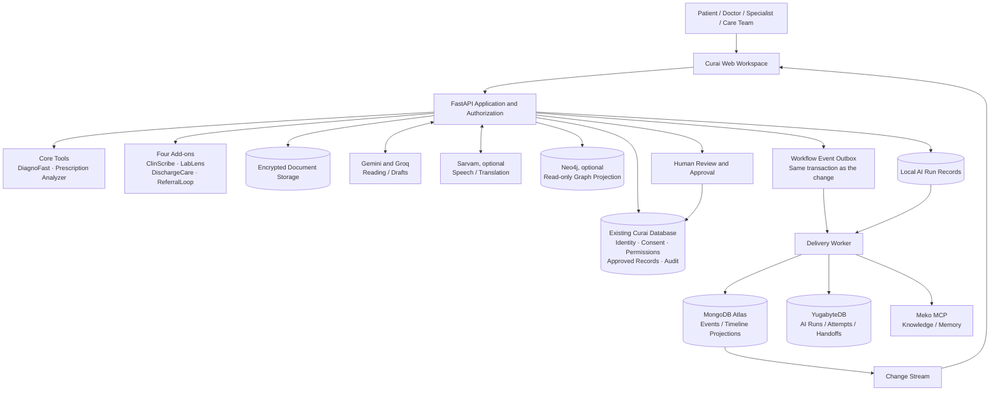
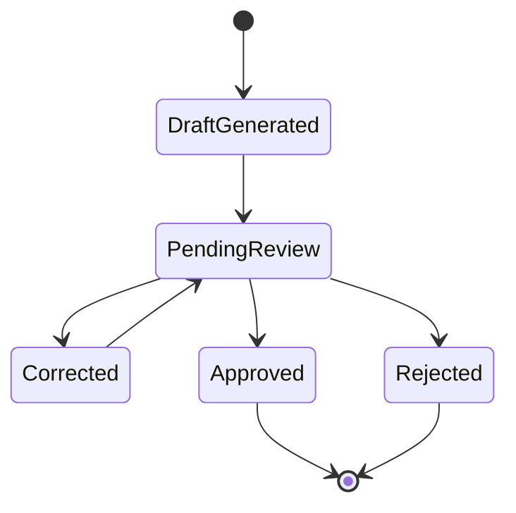

<h1 align="center">Curai</h1>

<p align="center">
  <strong>Healthcare that is connected, organised and intelligent.</strong><br />
  An AI-powered healthcare platform that brings patient records, medical history and clinical tools together in one place.<br />
  <sub>curai.in · support@curai.in · formerly Diagnosia</sub>
</p>

<p align="center">
  
  
</p>

<p align="center">
  <a href="#overview">Overview</a> ·
  <a href="#the-four-add-ons">Four Add-ons</a> ·
  <a href="#iiitd-hackathon-iteration">IIITD Iteration</a> ·
  <a href="#integrations">Integrations</a> ·
  <a href="#architecture">Architecture</a> ·
  <a href="#getting-started">Getting Started</a> ·
  <a href="#current-readiness-and-known-limitations">Safety & Readiness</a>
</p>

> [!CAUTION]
> **PILOT ONLY — NO-GO FOR REAL PATIENTS.** Curai is a development prototype. Use synthetic data only. It is not approved for diagnosis, treatment decisions, clinical deployment or storage of real patient information. Passing software tests does not establish clinical validity, regulatory compliance or production security.

---

## Contents

- [Overview](#overview)
- [The problem](#the-problem)
- [Product scope](#product-scope)
- [Core Curai tools](#core-curai-tools)
- [The four add-ons](#the-four-add-ons)
- [IIITD hackathon iteration](#iiitd-hackathon-iteration)
- [Integrations](#integrations)
- [How the technologies work together](#how-the-technologies-work-together)
- [Architecture](#architecture)
- [End-to-end demonstration](#end-to-end-demonstration)
- [Data ownership and review lifecycle](#data-ownership-and-review-lifecycle)
- [Technology stack](#technology-stack)
- [Getting started](#getting-started)
- [Configuration](#configuration)
- [Running and testing](#running-and-testing)
- [Security and safety boundaries](#security-and-safety-boundaries)
- [Current readiness and known limitations](#current-readiness-and-known-limitations)
- [Project documentation](#project-documentation)
- [Contributing](#contributing)
- [References](#references)

---

## Overview

**Curai is an AI-powered healthcare platform that brings patient records, medical history and clinical tools together in one place, helping doctors make better-informed decisions and manage their workflows more efficiently.** The goal is to make healthcare more connected, organised and intelligent. Patient intake, clinical documentation, laboratory reports, prescriptions, specialist referrals and discharge coordination all share one patient record.

The product has six tools: two core tools and four add-on modules, in the order of a visit. Optional integrations extend the platform in clearly separated roles:

| Integration | Responsibility in Curai |
|---|---|
| **Google Gemini API** | Multimodal understanding, structured extraction, summarization and controlled requests to existing backend functions |
| **YugabyteDB** | Technical records of AI runs, attempts and handoffs, in a database Curai owns |
| **Meko** | Shared agent context: approved knowledge, memory and handoff notes |
| **MongoDB Atlas** | Workflow events and timeline projections for the CareFlow view |

The goal is not to create a collection of disconnected AI demos. Curai is designed as one coordinated system: information enters through existing workflows, AI prepares reviewable drafts, authorized modules reuse relevant context, workflow events update the patient journey, and aggregated operational data helps clinics understand where coordination is getting delayed.

### At a glance

| | |
|---|---|
| **Product category** | Healthcare workflow and care-continuity platform |
| **Primary users** | Doctors, specialists, patients and care teams |
| **Core tools** | DiagnoFast (before the visit), Prescription Analyzer (after it) |
| **Add-on modules** | ClinScribe and LabLens (during the visit), ReferralLoop and DischargeCare (after it) |
| **Integrations** | Gemini, Groq, optional Sarvam and Neo4j, YugabyteDB, Meko, MongoDB Atlas |
| **Backend foundation** | Python, FastAPI and the existing Curai data/authentication layer |
| **Frontend** | HTML, CSS and JavaScript served by FastAPI |
| **Demo data policy** | Synthetic data only |
| **Readiness** | Pilot prototype; not approved for real-patient use |

## The problem

Healthcare information is fragmented across short consultations, handwritten prescriptions, laboratory documents, hospital discharge papers, specialist referrals and follow-up reminders. Even when individual tools work, the overall patient journey can still lose context between visits and care settings.

Curai focuses on four connected problems:

1. **Information capture:** patient history and supporting documents need to be collected in a usable, structured format.
2. **Clinical workflow fragmentation:** notes, laboratory reports, prescriptions, referrals and care tasks are often handled in separate workflows.
3. **Continuity gaps:** follow-ups, discharge tasks and referrals can remain incomplete or unconfirmed.
4. **Operational visibility:** care teams need to understand review backlogs and workflow delays without turning operational analytics into unsupported clinical decisions.

Curai is intended to assist and coordinate these workflows. It does not replace clinicians, pharmacists, laboratory professionals or other qualified healthcare staff.

## Product scope

The product consists of:

- The core Curai tools.
- The four add-on modules described below.
- The optional integrations.
- Shared platform capabilities required to connect, secure, observe and demonstrate those modules.
- One shared operational analytics view: the **Care Continuity Observatory**.

The Care Continuity Observatory is a platform-level analytics surface, **not a fifth clinical add-on**.

> **Implementation-status note:** the four add-ons have been built into Curai and exercised end to end as pilots. Gemini, YugabyteDB, Meko and MongoDB integrations are built. See [the testing guide](docs/integrations/TESTING.md) for how each is tested, and what a mock, a local stand-in and a real service each prove.

## Core Curai tools

These are the existing primary user-facing capabilities that form the foundation for the add-on workflows.

<details open>
<summary><strong>1. DiagnoFast — voice-first patient intake</strong></summary>

DiagnoFast helps collect a patient's history before or during a clinical visit. It is designed around conversational intake and structured preparation for the clinician.

**Existing workflow and technology**

- Voice-first patient history capture.
- Live browser speech recognition with an editable preview; Groq Whisper supplies a preview when live recognition is unavailable. Patients confirm each answer.
- Neural Indian English (Neerja) and Hindi (Swara) question playback through Edge-TTS, with Groq English and browser voice fallbacks.
- Six department choices, optional quick-answer chips, and a printable clinical requisition with source labels and physician workspace.
- AI-assisted extraction into structured intake fields and a concise clinician-facing draft.
- Two-layer urgent-symptom check: plain rules in English, Hindi and romanised Hindi run before the AI on every answer and end the interview at once, even when the AI is unavailable; the AI's own urgent list is the second layer.
- Intended support for Hindi and Indian English workflows.

**Self-service kiosk:** set `DIAGNOFAST_KIOSK_DOCTOR_ID` to the numeric user ID of a verified clinic doctor, restart the server, and open `/intake.html`. No patient links need to be created in advance. Visits enter that doctor's queue. Without this setting, reception-created links still work. The kiosk cannot attach existing charts or fetch ABHA history. Neural speech is enabled by default; set `CURAI_NEURAL_TTS=0` to disable Microsoft question playback.

**Integration status**

Each interview step is recorded in CareFlow: the link, the start, each transcribed answer, completion and the report waiting for a doctor. AI runs are recorded with the provider that answered.

**Boundary:** patient statements remain patient-reported information until reviewed. DiagnoFast does not independently diagnose, triage or prescribe.
</details>

<details open>
<summary><strong>2. Prescription Analyzer — prescription understanding and guidance</strong></summary>

The Prescription Analyzer helps interpret prescription images and explain readable instructions in a patient-friendly format.

**Existing safety design**

- Extracted fields are classified as `clear`, `unsure` or `unreadable`.
- A deterministic shorthand engine interprets common notation such as `1-0-1`, `OD`, `BD`, `TDS`, `AC`, `PC`, `HS` and `SOS`.
- The patient confirms candidate medication information before downstream explanation.
- Unclear instructions are surfaced for pharmacist/doctor confirmation.
- The system must not silently alter a dose, substitute a brand or recommend stopping a medication.

**Integration status:** Gemini is the first choice for reading prescription photos, and Groq is the fallback. Every medicine still needs the patient's confirmation. CareFlow records the steps and never the medicines.

**Boundary:** model extraction is not a verified prescription or medication order.
</details>

## The four add-ons

The four add-ons share the Curai patient-record and workflow foundation. They are designed to exchange relevant, permission-controlled context rather than act as four unrelated applications.

| Add-on | Purpose | Main users | Primary output |
|---|---|---|---|
| **ClinScribe** | Clinical documentation and encounter summarization | Doctor, clinician | Structured note draft with source references and review state |
| **LabLens** | Laboratory report extraction and review | Patient, doctor, lab reviewer | Structured report draft with source and uncertainty metadata |
| **DischargeCare** | Discharge transition and post-discharge coordination | Hospital team, patient, care team | Discharge summary and candidate follow-up tasks |
| **ReferralLoop** | Specialist referrals and back-referral tracking | Referring doctor, specialist, care team | Referral status, appointment/consultation milestones and returned-note tracking |

<details>
<summary><strong>ClinScribe — AI clinical documentation</strong></summary>

ClinScribe turns clinician-entered information (text or voice transcript) into a structured encounter-note draft. Its role is to reduce repetitive documentation while keeping the clinician responsible for the final note.

**CareFlow:** records session, draft, review and sign-off steps, and names the model that drafted. ClinScribe drafts from the consultation transcript alone. It doesn't read lab results or shared context.

**Guardrail:** generated text stays a draft until the clinician reviews and approves it. The system must not invent an examination finding, diagnosis or treatment plan.
</details>

<details>
<summary><strong>LabLens — laboratory report digitisation and review</strong></summary>

LabLens extracts laboratory report content into structured, reviewable fields. The workflow is designed to retain the original source, preserve test names and values, and expose uncertainty for human correction.

**CareFlow:** records each report from receipt to confirmation. Text PDFs are read locally, and scanned reports by Gemini first, then Groq. Confirmed results become observations in the patient record.

**Current pilot limitations:** the parser has been exercised against synthetic layouts, not a representative real-world Indian laboratory dataset. The reported synthetic test set found 37/37 expected tests, but that is not a real-world accuracy claim. None of the 49 proposed LOINC mappings is approved; exports retain the laboratory's own test name rather than presenting an unreviewed mapping as verified.

**Guardrail:** extracted values remain drafts until reviewed. Do not infer missing values or silently normalize uncertain units.
</details>

<details>
<summary><strong>DischargeCare — discharge and transition coordination</strong></summary>

DischargeCare organizes discharge information and candidate post-discharge tasks so that a transition from hospital to home or another care setting has traceable next steps.

**CareFlow:** records the episode, checklist changes, approval and closure.

**Guardrail:** extracted tasks require human verification before becoming active care tasks. Summarization is not a substitute for discharge instructions or clinical review.
</details>

<details>
<summary><strong>ReferralLoop — specialist referral and back-referral tracking</strong></summary>

ReferralLoop tracks a referral from request through routing, scheduling, specialist encounter and return of a consultation note. It focuses on coordination and preventing referrals from silently falling through workflow gaps.

**CareFlow:** records every referral step from creation to closure, including contact attempts and priority changes.

**Guardrail:** referral urgency and clinical appropriateness remain decisions for qualified clinicians. Workflow analytics must not silently prioritize or deprioritize patients.
</details>

## IIITD hackathon iteration

The `iiitd` branch adds a synthetic-data-only DiagnoFast demonstration flow. Every addition is behind a Settings switch that starts off, so the established workflow remains unchanged until an administrator deliberately enables an add-on. Sarvam and Neo4j also stop entirely when real-patient data is allowed.

### Added patient and staff flow

1. **OPD booking:** reception books a patient into a doctor's slot, assigns a per-doctor queue number and department, and places a neutral interview-link message in a demo SMS/WhatsApp outbox. Nothing is sent to a phone.
2. **Slot QR login:** a server-generated QR code starts a short-lived, rate-limited phone-and-OTP flow. In demo mode the OTP is displayed on screen; after verification the patient chooses from only their masked bookings and receives a normal one-interview link.
3. **Patient status:** after a booked interview, the link becomes a read-only status page for the day. It shows the queue number, department and the patient's own answers; an AI summary remains hidden until a doctor reviews it.
4. **Guided interview and report:** the optional question graph supplies follow-up and red-flag screening prompts, while the existing controlled interview rules still enforce the 12-question limit and always ask about medicines and allergies. The report can show an evidence graph and machine-labelled English translations of confirmed Hindi answers.
5. **Staff-only assistance:** a graph can suggest a walk-in department for staff confirmation. Referral-network views and medicine/allergy conflict flags are likewise staff-facing aids, not patient advice or automated decisions.

### Add-on status and guardrails

| Add-on | Current implementation | Remaining boundary or evidence need |
|---|---|---|
| Sarvam AI | Optional Saaras v4 transcription, Bulbul question/status playback and Mayura translation; it may also be selected as a third text-provider fallback. A synthetic live smoke test has passed. | Requires its feature switch, API key and recorded `sarvam_terms` sign-off; its data location and training terms need owner approval. |
| Neo4j | Optional read-only question, history and evidence graphs. SQLite remains authoritative; Neo4j receives only IDs and coded terms. The local Neo4j 5.26 live check passed 12/12 with made-up data. | The question graph is not clinically reviewed. With Neo4j off or unavailable, the app falls back to existing SQLite/AI behaviour. |
| Hinglish urgent screening | English, Hindi and romanised-Hindi deterministic screening remains in front of the AI check. | The new Hinglish development set has only 4/20 deterministic urgent matches. Any rule expansion needs an explicit safety decision and clinician-labelled evaluation. |
| Messaging and OTP | A demo outbox, QR and OTP workflow are implemented. | No SMS or WhatsApp provider is connected; no real message is sent. |

This iteration does not change the clinical boundary: AI never diagnoses, chooses a department for a patient, changes a dose, or decides whether a symptom is serious. Use made-up patients only.

## Integrations

Each has one job, and none replaces the Curai database. All are optional, and off by default. [TESTING.md](docs/integrations/TESTING.md) explains how each is tested. Local stand-ins are never reported as these services.

### 1. Google Gemini API: reading documents

Gemini is the first choice for reading prescription photos, reading scanned lab reports, and explaining a prescription. If it's busy, a smaller Gemini model takes over, then Groq. Other tools use Groq first, with Gemini as a fallback. Output is checked against a schema and a person reviews it. Gemini has no function calling here, and can't request anything from the backend.

### 2. YugabyteDB and Meko: execution records and shared context

These are two separate things. **YugabyteDB** is Curai's own database, holding technical records of each AI run, its attempts and each handoff, so nothing about a request depends on it. **Meko** holds approved knowledge and notes that a handoff happened, reached only through its documented MCP server. Its internal database is never touched.

Neither is a clinical record, and neither proves identity, consent or approval. A receiving tool always re-reads the source record.

### 3. MongoDB Atlas: the CareFlow timeline

Atlas stores one safe event for each workflow step and a prepared summary for each workflow. Events are written to a local outbox in the same transaction as the change they describe, then delivered, retried and deduplicated. Change Streams update open screens straight away, with a 15-second refresh as the fallback.

### 4. Sarvam AI: optional Indian-language speech and translation

The IIITD iteration can use Sarvam's speech-to-text, text-to-speech and translation services for DiagnoFast. The patient still confirms text before it becomes the record; translation is shown to clinicians beside the original and labelled as machine translation. It is optional, disabled by default and blocked unless a configured key, the `sarvam_terms` sign-off and made-up-patient mode are all present. See [the Sarvam integration notes](docs/integrations/SARVAM.md).

### 5. Neo4j: optional read-only DiagnoFast graphs

Neo4j can project completed SQLite records into question, history and evidence graphs. It never becomes the patient-record authority and never writes back to SQLite. The projection holds IDs and coded terms only; text shown to a user is re-read from SQLite after the normal access check. See [the Neo4j integration notes](docs/integrations/NEO4J.md).

### Which tool uses what

| Tool | AI | CareFlow events | Handoff |
|---|---|---|---|
| DiagnoFast | Gemini first for confirmed-answer extraction; optional Sarvam speech/translation and configurable fallback | Yes | None |
| Prescription Analyzer | Gemini, then Groq | Yes | None |
| ClinScribe | Groq, then Gemini | Yes | None |
| LabLens | Gemini, then Groq, for scans | Yes | None |
| DischargeCare | None | Yes | None |
| ReferralLoop | None | Yes | None |

## How the technologies work together

Each layer does one job:

1. **AI reads and drafts:** Gemini or Groq returns structured candidates, checked against a schema. The optional Sarvam add-on handles speech and translation for DiagnoFast.
2. **Curai validates:** permissions, consent and workflow rules are applied, and the result is saved as a draft.
3. **A person reviews:** clinical content stays pending until an authorized person approves it.
4. **The outbox records it:** an event commits in the same transaction as the change.
5. **MongoDB shows the journey:** the worker delivers the event, and CareFlow's timeline updates.
6. **YugabyteDB and Meko keep the rest:** technical AI and handoff records go to YugabyteDB, and handoff notes to Meko.
7. **Neo4j projects completed records only:** its optional graphs guide questions and show provenance, while SQLite remains authoritative.

## Architecture



### Data ownership rules

| Data category | Authoritative owner | Role of the integration |
|---|---|---|
| Accounts, sessions, staff verification | Existing Curai database | No integration becomes the identity authority |
| Patient identity, consent and care-team access | Existing Curai database | Meko, Atlas and YugabyteDB must not override access decisions |
| Approved clinical records and audit events | Existing Curai database | Gemini creates drafts, Meko supplies context, and Atlas holds workflow projections |
| Original clinical document | Curai encrypted document storage | Never copied to Gemini for keeping, or to Meko, Atlas or YugabyteDB |
| Shared agent context | Meko, bounded by Curai authorization | Context retrieval and agent handoffs |
| Workflow timeline | MongoDB Atlas projection | Flexible event persistence and Change Streams |
| AI run, attempt and handoff records | Local run records, copied to YugabyteDB | Technical metadata only |
| AI inference | Gemini API | Inference only; no authority to approve clinical records |
| DiagnoFast speech and translation | Sarvam, when explicitly enabled | Optional inference only; confirmed text and SQLite remain authoritative |
| DiagnoFast graph projection | Neo4j, when explicitly enabled | Read-only IDs and coded terms; SQLite is always authoritative |

### Why the separation matters

Putting the same patient data into every system would create conflicting sources of truth, duplicate retention obligations, difficult deletion workflows and more places where sensitive data could be exposed. Each system therefore has one defined responsibility. The existing Curai database remains the authority for identity and approved records; the integrations extend context, event tracking and analytics.

## End-to-end demonstration

The demo uses one clearly synthetic case, `case_demo_001`, and goes through the real routes.

```bash
.venv/bin/python -m backend.operator_cli careflow-demo             # fixed answers, no AI cost
.venv/bin/python -m backend.operator_cli careflow-demo --real-ai   # real Gemini and Groq, synthetic data
```

Sign in as `careflow.demo.doctor@example.com` with `Synthetic-demo-only-1`, and open **CareFlow**.

1. **DiagnoFast** runs an interview, and its report waits for a doctor.
2. **LabLens** reads two text reports locally and a scanned one with Gemini. The AI run goes to YugabyteDB.
3. **DischargeCare** opens a discharge episode, and **ClinScribe** drafts a note that waits for a clinician.
4. **ReferralLoop** follows a referral to a booked appointment.
5. **Failure and recovery:** run `python -m backend.tests.local_stack.end_to_end`, which interrupts a destination and shows recovery with no duplicates.

CareFlow shows all of this in order, says which store it came from, and updates without a reload.

## Data ownership and review lifecycle

All AI-generated clinical content follows a review lifecycle. The exact state names should match the implementation, but the conceptual process is:



- **Draft generated:** model output is stored with provider, timestamp, model/version where available, source reference and extraction metadata.
- **Pending review:** the UI clearly marks the information as unreviewed.
- **Corrected:** a human edits a candidate field; the correction remains attributable.
- **Approved:** an authorized reviewer accepts the information under the existing workflow.
- **Rejected:** an unsuitable or incorrect draft is retained/handled according to the applicable audit and retention policy, not silently promoted.

The current implementation reports that unreviewed material is highlighted and excluded from the approved record and FHIR exports. Keep this backend-enforced; a frontend badge alone is not a safety control.

## Technology stack

The stack as implemented.

| Layer | Technology | Responsibility |
|---|---|---|
| Backend API | Python, FastAPI | Application endpoints, workflow orchestration and authorization |
| Data validation | Pydantic | Request/response schemas and validation |
| Existing database | SQLite in the documented development setup; configured through `CURAI_DB` | Existing accounts, sessions and patient/workflow records |
| Data access | Plain `sqlite3` with parameterised SQL | Persistence |
| Frontend | HTML, CSS, JavaScript | Landing pages, auth, dashboards and care workspace |
| Language models | Google Gemini and Groq, with optional Sarvam fallback | Structured extraction, drafting and reading |
| Speech | Optional Sarvam, Edge neural questions, Groq Whisper/Orpheus, browser speech | Voice interview, transcript preview and read-aloud |
| Graph projection | Optional Neo4j | Read-only question, history and evidence graphs for DiagnoFast |
| Shared context | Meko, through MCP | Approved knowledge, memory and handoff notes |
| Execution records | YugabyteDB, through YSQL | AI runs, attempts and handoffs |
| Workflow event store | MongoDB Atlas | Events and CareFlow timeline projections |
| Document protection | AES-256-GCM encrypted document storage | Protect uploaded reports and documents at rest |
| Authentication security | Argon2id password hashing, hashed session tokens and HttpOnly cookies | Credential and session protection |

Exact versions and final deployment topology should be taken from the repository's dependency and environment files rather than inferred from this overview.

## Getting started

> These instructions describe the documented local development setup. Use synthetic data only. Some optional integrations require credentials and a configured service endpoint.

### Prerequisites

- Python 3.12 recommended (Python 3.11 may be supported by the project dependencies).
- [`uv`](https://docs.astral.sh/uv/) for Python environment and dependency management.
- Git.
- A browser such as Chrome for the local workspace.
- Optional API/service credentials for integrations being tested.

### 1. Clone the repository

Replace the placeholder with the repository URL provided by the project owner.

```bash
git clone <YOUR_CURAI_REPOSITORY_URL>
cd curai
```

### 2. Create the environment and install dependencies

```bash
uv venv .venv --python 3.12
source .venv/bin/activate
uv pip install -r backend/requirements.txt
```

On Windows PowerShell, activate the environment with:

```powershell
.venv\Scripts\Activate.ps1
```

### 3. Configure environment variables

```bash
cp .env.example .env
```

Open `.env` and configure only the services required for the workflow you are testing. See [Configuration](#configuration). Never commit `.env`, API keys, database credentials or document-encryption keys.

### 4. Generate the document-encryption key

Document uploads require the configured encryption key. Generate a local key file using the operator CLI:

```bash
.venv/bin/python -m backend.operator_cli generate-key --path ~/.curai/document-keys.json
```

Set `CURAI_DOCUMENT_KEY_FILE` in `.env` to that file path. Store a protected backup separately from the repository and test the recovery procedure. **Losing the key can make encrypted documents permanently unreadable.** Do not share the key or add it to Git.

Uploads should fail closed when the key is missing or invalid.

### 5. Bootstrap the first organization administrator

Public doctor registration does not make a staff account verified. The first organization administrator must be provisioned through the documented server-side operator workflow.

Inspect the available commands and their exact arguments with:

```bash
.venv/bin/python -m backend.operator_cli --help
.venv/bin/python -m backend.operator_cli bootstrap-organization --help
```

Follow the operator documentation in the repository. Do not invent or bypass staff verification.

### 6. Start Curai

```bash
.venv/bin/uvicorn backend.app:app --host 127.0.0.1 --port 8001 --reload
```

Open the local care workspace:

**[http://127.0.0.1:8001/care.html](http://127.0.0.1:8001/care.html)**

The landing page is available at `http://127.0.0.1:8001/` when served by the documented static frontend setup.

## Configuration

The environment file is local-only. The following keys are documented in the existing project material; check `.env.example` and `backend/config.py` for the exact current supported names and defaults.

| Variable | Purpose | Notes |
|---|---|---|
| `GROQ_API_KEY` | Groq AI and speech | Do not send real patient data; vendor approval is outstanding |
| `GEMINI_API_KEY` | Gemini AI | Do not send real patient data; vendor approval is outstanding |
| `CURAI_HTTPS` | Secure cookies and the HSTS header | Set to 1 only when the site is served over HTTPS; do not expose the app publicly by accident |
| `CURAI_SESSION_IDLE_MINUTES` | Minutes of no activity before a session is signed out | Default 30; 0 turns the idle limit off (the 12-hour staff and 14-day patient lifetimes still apply) |
| `CURAI_DB` | Existing database path | Defaults and actual path are defined by `backend/config.py` |
| `CURAI_DOCUMENT_KEY_FILE` | Document encryption key file | Keep outside the repository; back up separately and securely |

MongoDB Atlas, YugabyteDB and Meko are built, optional and off by default. See [the setup guide](docs/integrations/SETUP.md). Their variables are in
`.env.example`, and setup is in [docs/integrations/](docs/integrations/ARCHITECTURE.md). CareFlow works
with none of them, from a local outbox. For a repeatable synthetic journey, run
`.venv/bin/python -m backend.operator_cli careflow-demo`, then sign in as
`careflow.demo.doctor@example.com` with `Synthetic-demo-only-1` and open CareFlow.

No tool produces a handoff today. The support for handoffs between tools (events with a target module, the YugabyteDB
handoff records and the Meko notes) stays in the code, and is tested with synthetic events, for a future tool to use.

Gemini configuration must use the exact variable names and connection settings implemented in the relevant integration adapters and `.env.example`. This README intentionally does not invent names or credentials. Keep service-specific secrets in environment variables or an approved secret manager.

## Running and testing

Run the repository's normal automated test suite from the project root:

```bash
.venv/bin/pytest -q
```

### What the suite needs

The suite needs no API keys and no network: every AI and speech call is replaced by a fake. Live tests against the real AI providers and integrations are marked `live`, skipped by default, and described in [docs/integrations/TESTING.md](docs/integrations/TESTING.md), along with the browser microphone check and the synthetic lab report layouts.

The IIITD additions have unit tests using fakes. A Sarvam synthetic smoke test and a local Neo4j 5.26 live check have been run with made-up data; rerun live checks after changing models, credentials, graph content or driver versions. The exact commands and what each test proves are in [the integration testing guide](docs/integrations/TESTING.md).

Not yet demonstrated:

- Real microphone recording and real speech on real devices.
- MongoDB Atlas and Meko themselves, which need credentials.
- Safari and Firefox compatibility.
- SMS or automated voice reminders.
- Validation against real Indian laboratory reports or representative external datasets.
- Independent penetration testing.

## Security and safety boundaries

Curai incorporates safeguards in its pilot implementation, including:

- Password hashing using Argon2id.
- Hashed session tokens and HttpOnly session cookies.
- Staff accounts beginning in a pending-verification state; verification requires an administrator of a verified organization.
- Consent enforcement and immediate effect of revocation in the documented workflows.
- Audit events designed to be tamper-resistant, with patient-visible record-access history.
- AES-256-GCM document encryption, with uploads refused when the required key is unavailable.
- Unreviewed AI output visibly marked and excluded from approved clinical records and FHIR exports.
- Cross-organization/cross-site access restrictions.
- Pilot-mode controls that prevent real-patient operation until readiness requirements are satisfied.
- Rate limits on the public kiosk, DiagnoFast patient links and prescription read-aloud, counted in SQLite and storing only hashed keys.
- Rule-based urgent-symptom screening in DiagnoFast (English, Hindi, romanised Hindi), which sends the patient to reception even when the AI is unavailable.

These controls reduce risk but do not establish regulatory compliance or production security. Configuration, deployment, independent testing and professional review remain necessary.

## Current readiness and known limitations

**Latest reported assessment: NO-GO for real patients.** All 10 required human sign-offs are outstanding, and the readiness checks fail until they are recorded. Run `python -m backend.operator_cli readiness` for the current count; that command is the source of truth.

| Area | Current known state |
|---|---|
| Overall deployment | Pilot only; synthetic data only |
| LOINC | 49 proposed mappings remain unapproved; local laboratory test names are retained in exports |
| Reminders | In-app/staff follow-up workflow; SMS and voice channels are not connected |
| Staff security | MFA and password-reset work remain open in the latest reported review |
| Patient rights workflows | Whole-record export and erasure workflows remain open in the latest reported review |
| Security assurance | Independent penetration test remains outstanding |
| Vendors | Groq, Gemini, Atlas and Meko data terms require approval before any real data |
| IIITD add-ons | Sarvam and Neo4j are optional, disabled by default and limited to made-up patients; Sarvam requires a sign-off before it can run |
| Hinglish safety | Deterministic urgent screening needs clinician-led improvement and evaluation before any reliance beyond its current development evidence |
| Privacy/regulation | DPDP and CDSCO assessments, notices and legal review remain open; generic FHIR is not ABDM compliance |
| Lab validation | Synthetic report layouts only; real Indian lab formats have not been validated |

### Human approvals are not software features

Clinical validation, laboratory terminology review, CDSCO/regulatory advice, privacy/legal approval, AI vendor agreements and independent security assessment require qualified external people or organizations. Passing tests or generating a sign-off form does not satisfy those requirements.

## Project documentation

The repository's `docs/` directory contains the detailed implementation and governance material. Start here:

| Document | Purpose |
|---|---|
| [`docs/CLINICAL_GOVERNANCE.md`](docs/CLINICAL_GOVERNANCE.md) | Clinical safety boundaries, review requirements and governance decisions |
| [`docs/SECURITY_REVIEW.md`](docs/SECURITY_REVIEW.md) | Security findings and remaining technical work |
| [`docs/AUDIT_AND_REFINEMENT_PLAN.md`](docs/AUDIT_AND_REFINEMENT_PLAN.md) | The audit register, work items, order of work and owner decisions from the November 2026 review |
| [`docs/DATA_PROTECTION_AND_RETENTION.md`](docs/DATA_PROTECTION_AND_RETENTION.md) | Document protection, privacy and retention considerations |
| [`docs/PRODUCTION_DEPLOYMENT_CHECKLIST.md`](docs/PRODUCTION_DEPLOYMENT_CHECKLIST.md) | Deployment prerequisites and readiness controls |
| [`docs/integrations/TESTING.md`](docs/integrations/TESTING.md) | How each kind of test is run, and what it proves |
| [`docs/addons/`](docs/addons/) | One detailed document for each of the four add-ons |
| [`THIRD_PARTY_NOTICES.md`](THIRD_PARTY_NOTICES.md) | Third-party acknowledgements, reused material and license notices |

If a linked document is absent in a particular branch or release, treat the link as a documentation task rather than assuming the requirement has been met.

## Contributing

Curai is one product on one shared patient record. Before adding a new standalone tool, chatbot, diagnostic engine or parallel patient database, agree it as a product decision with the project owner.

Useful contributions include:

- Fixing defects and improving reliability without weakening safety checks.
- Improving provenance, review workflows, permission enforcement and auditability.
- Strengthening automated tests and reproducible synthetic demo scenarios.
- Completing and testing the optional integrations.
- Improving accessibility, documentation, deployment repeatability and observability.
- Resolving readiness blockers and preparing evidence for qualified reviewers.

Branch from `main`, run the test suite, and open a pull request. See [`agent_context.md`](agent_context.md) for the rules every change must keep. Before making changes, inspect `git status` and preserve existing uncommitted work. Never commit secrets, patient information, encryption keys or local database files.

## References

### Integrations

- [Google Gemini API documentation](https://ai.google.dev/gemini-api/docs)
- [Gemini document processing](https://ai.google.dev/gemini-api/docs/document-processing)
- [Gemini structured output](https://ai.google.dev/gemini-api/docs/structured-output)
- [Gemini function calling](https://ai.google.dev/gemini-api/docs/function-calling)
- [Meko documentation](https://docs.mekodata.ai/)
- [Meko architecture](https://docs.mekodata.ai/architecture/how-meko-fits/)
- [Meko MCP server reference](https://docs.mekodata.ai/reference/mcp-server/)
- [MongoDB Atlas](https://www.mongodb.com/atlas)
- [MongoDB Change Streams](https://www.mongodb.com/docs/manual/changestreams/)
- [YugabyteDB YSQL](https://docs.yugabyte.com/stable/api/ysql/)

### Other technology

- [FastAPI](https://fastapi.tiangolo.com/)
- [Pydantic](https://docs.pydantic.dev/)
- [Groq](https://console.groq.com/docs)
- [ABDM FHIR Implementation Guide](https://www.nrces.in/ndhm/fhir/r4/)

---

<p align="center">
  <strong>Curai</strong><br />
  Connecting clinical information, care workflows and operational insight.<br />
  <sub>A synthetic-data pilot. Human review remains essential.</sub>
</p>
