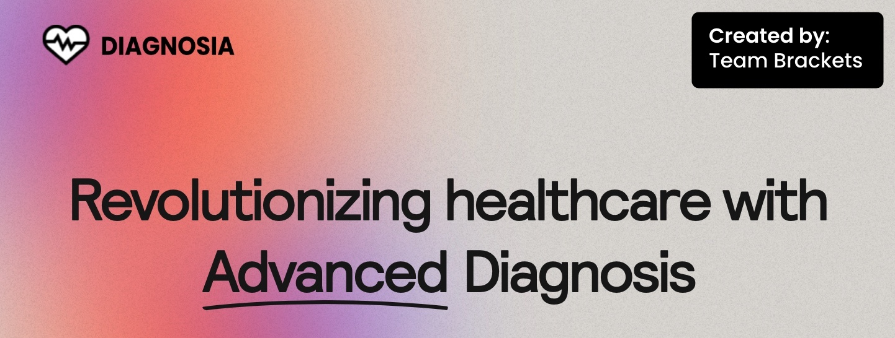
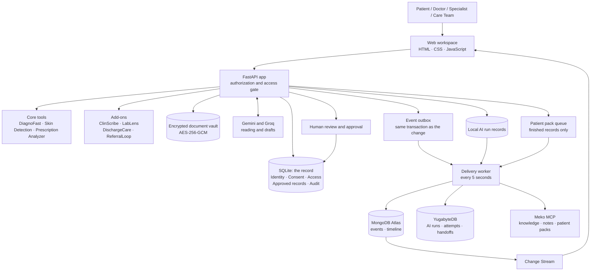
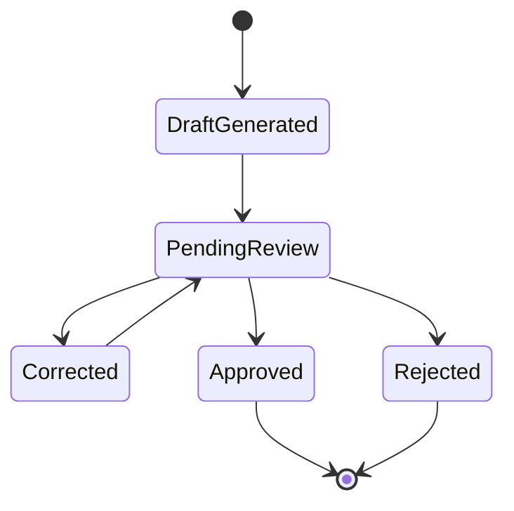

<p align="center">
  
</p>

<h1 align="center">Diagnosia</h1>

<p align="center">
  <strong>AI tools that help doctors work faster and help patients understand their care.</strong><br />
  A healthcare workspace for India, where consultations often last about two minutes.
</p>

<p align="center">
  
  
  
  
  
  
  
  
  
</p>

<p align="center">
  
  
  
  
  
  
</p>

<p align="center">
  
  
  
  
  
  
</p>

<p align="center">
  <a href="#overview">Overview</a> ·
  <a href="#the-tools">Tools</a> ·
  <a href="#integrations">Integrations</a> ·
  <a href="#architecture">Architecture</a> ·
  <a href="#getting-started">Getting started</a> ·
  <a href="#safety-and-readiness">Safety</a> ·
  <a href="#documentation">Docs</a>
</p>

> [!CAUTION]
> **PILOT ONLY. NO-GO FOR REAL PATIENTS.** Diagnosia is a student-built prototype for demos and hackathons. Use made-up patients only. It is not approved for diagnosis, treatment decisions, clinical use or storage of real patient information. Passing tests does not establish clinical validity, regulatory compliance or production security.

---

## Contents

- [Overview](#overview)
- [The problem](#the-problem)
- [The tools](#the-tools)
  - [Core tools](#core-tools) · [Add-on tools](#add-on-tools) · [OptiKinesis](#optikinesis)
- [Integrations](#integrations)
  - [Google Gemini](#google-gemini) · [YugabyteDB](#yugabytedb) · [Meko](#meko) · [MongoDB Atlas](#mongodb-atlas)
  - [What has been proved live](#what-has-been-proved-live) · [Which tool uses what](#which-tool-uses-what)
- [Architecture](#architecture)
- [Demo walkthrough](#demo-walkthrough)
- [Technology stack](#technology-stack)
- [Getting started](#getting-started)
- [Configuration](#configuration)
- [Running the tests](#running-the-tests)
- [Safety and readiness](#safety-and-readiness)
- [Repository layout](#repository-layout)
- [Documentation](#documentation)
- [Contributing](#contributing)
- [References](#references)

---

## Overview

India has too few doctors, so a consultation can last about two minutes. Diagnosia is a set of AI tools that fit around a patient's visit: one before it, three during it and three after it. A person reviews everything the AI produces. The AI never diagnoses.

| Stage | Tool | What it does |
|---|---|---|
| Before the visit | **DiagnoFast** | Interviews the patient by voice in their own language while they wait, and writes a one-page report |
| During the visit | **ClinScribe** | Turns a consultation into a draft note for the doctor to check and sign |
| | **LabLens** | Reads lab reports into results that a person confirms |
| | **Skin Cancer Detection** | Screens a dermoscopic image and gives an early second opinion with a heatmap |
| After the visit | **Prescription Analyzer** | Reads a prescription photo and explains it in plain Hindi or English, with audio |
| | **ReferralLoop** | Follows a referral from request to returned outcome |
| | **DischargeCare** | Turns a discharge plan into a checklist for the family |

A separate project, [OptiKinesis](#optikinesis), gives people who can't use their hands a way to control a computer.

### At a glance

| | |
|---|---|
| **Category** | Healthcare workflow and care-continuity platform for India |
| **Users** | Doctors, specialists, patients and care teams |
| **Tools** | 7 in this repository, plus OptiKinesis in its own repository |
| **Integrations** | Gemini, YugabyteDB, Meko and MongoDB Atlas. All optional and off by default |
| **Backend** | Python 3.12 and FastAPI, with SQLite as the record |
| **Frontend** | Plain HTML, CSS and JavaScript, with no framework and no build step |
| **Languages** | Hindi and English |
| **Data policy** | Synthetic data only |
| **Readiness** | Pilot prototype. Not approved for real patients |

## The problem

Healthcare information is spread across short consultations, handwritten prescriptions, lab documents, discharge papers, referrals and follow-ups. Even when each tool works, the patient's journey loses context between visits.

1. **Information capture:** a patient's history needs to be collected in a form a doctor can use quickly.
2. **Fragmented workflows:** notes, lab reports, prescriptions, referrals and tasks live in separate places.
3. **Continuity gaps:** follow-ups, discharge tasks and referrals can stay unfinished or unconfirmed.
4. **Understanding:** patients often leave without understanding their prescription.

Diagnosia assists these workflows. It does not replace doctors, pharmacists, lab professionals or other qualified staff.

---

## The tools

The tool list has one source, `web/js/care/catalogue.js`, in the order of a visit. The public page `index.html` repeats it by hand, and a test checks that the two agree.

### Core tools

<details open>
<summary><strong>DiagnoFast: voice-first patient intake</strong></summary>

DiagnoFast fills a doctor's custom form by interviewing the patient while they wait.

- **Six forms** in `backend/diagnofast/forms/*.json`: general medicine, dermatology, cardiology, orthopedics, ENT and pediatrics. The team writes these by hand, with no form builder.
- **Single-use links.** Reception creates a link for each patient. The patient needs no account, and the link stops working when the interview ends. Only a hash of the link is stored.
- **Self-service kiosk.** Set `DIAGNOFAST_KIOSK_DOCTOR_ID` to the user ID of a verified doctor and open `/intake.html`. New visits go only to that doctor's queue. A kiosk visit cannot attach a chart, choose a doctor or fetch ABHA records.
- **A controlled loop, not a free-running agent.** The AI picks the next question and extracts fields. Code keeps the rules: only fields on the form are kept, required fields must be filled, there are at most 12 questions, and urgent symptoms (chest pain, trouble breathing and similar) end the interview and send the patient to reception.
- **Voice.** Edge neural voices read questions in Indian English (Neerja) and Hindi (Swara). The browser recognizes speech live, and Groq Whisper supplies a transcript preview when it can't. The patient edits and confirms each answer before sending. Typing is always available. Each recording is capped near 28 seconds.
- **Report.** Doctors see a queue with urgent patients first, and a printable one-page requisition with the patient's recording and transcript. Unasked symptoms are never shown as normal.
- **ABHA history is simulated.** Real access needs ABDM sandbox approval, an exit review and a security audit.

**Boundary:** patient statements stay patient-reported until a doctor reviews them. DiagnoFast does not diagnose, triage or prescribe.
</details>

<details open>
<summary><strong>Skin Cancer Detection: image screening for a second opinion</strong></summary>

A research demo that screens a dermoscopic lesion image. It is **not clinically validated** and **not licensed for sale**.

- **Model.** A PanDerm (ViT-L) encoder with a classifier trained on ISIC 2019, split by lesion so that no lesion is in both training and test. Eight classes: `MEL`, `BCC`, `SCC`, `AK`, `BKL`, `DF`, `NV`, `VASC`.
- **Measured on 3,619 unseen images** (`backend/skin/metrics.json`): macro AUROC 0.934 and melanoma AUROC 0.881. Balanced accuracy is 60.5%. It sends 90.1% of melanomas and 94.3% of concerning lesions for referral, and also refers 42.7% of benign lesions. It is a cautious screener, not a precise classifier.
- **"Uncertain" for unfamiliar images.** Blurry images, wrong pictures and photos that aren't skin return **uncertain** with no scores. This uses Mahalanobis distance, which caught all 95 non-skin images tried. The earlier cosine check caught 8%.
- **Occlusion heatmap.** The map hides each patch and measures the drop in score. Grad-CAM and attention maps showed almost no agreement with it, so they would have misled doctors.
- **Hardware.** About 3 seconds per image on a 6 GB RTX 4050, and about 2 minutes on a CPU. Without the model files, `/api/skin/analyze` returns 503 and the rest of the app is unaffected.
- **Licences.** PanDerm (CC-BY-NC-ND 4.0) and ISIC 2019 (CC-BY-NC) are for non-commercial research. The tool must stay out of paid plans and be replaced before anyone is charged.

**Boundary:** the result always says it is not a diagnosis. Gemini never replaces or overrules the skin model. A CDSCO regulatory review is needed before any real use.
</details>

<details open>
<summary><strong>Prescription Analyzer: understand a prescription</strong></summary>

Nothing is explained until the patient confirms it.

1. **Read.** Up to 4 photos of one prescription go to a vision model that returns a fixed structure and marks each field `clear`, `unsure` or `unreadable`. It is told never to guess.
2. **Decode.** `shorthand.py` decodes `OD`, `BD`, `TDS`, `HS`, `SOS`, `BBF`, `1-0-1` and similar with plain rules, not AI. It returns nothing rather than guessing. A fixed schedule is withheld when the marks disagree with the written frequency, and `SOS`/`PRN` medicines never get a fixed time.
3. **Check names.** Each name is compared with a list of about 250,000 Indian medicines. Names are only flagged as found, close ("Did you mean ...?") or not found, and are never changed. A "clear" name that isn't in the list becomes "unsure".
4. **Confirm.** The patient ticks each medicine that matches their prescription. Unticked or unreadable ones go to "ask your pharmacist" and never reach the explanation.
5. **Explain.** Only confirmed medicines are explained, in the patient's language, with audio, diet, yoga and a schedule. It never changes a dose or suggests a substitute.

The photo isn't stored. A consent box says it goes to outside AI services. The same photo can read differently between runs, so the confirmation step is the safety net.

**Boundary:** model extraction is not a verified prescription or medication order.
</details>

### Add-on tools

The four add-ons share one patient record and an access gate with an audit log. They exchange only permission-controlled context.

| Add-on | Purpose | Output |
|---|---|---|
| **ClinScribe** | Clinical documentation | A structured note draft from the consultation transcript, with review state |
| **LabLens** | Lab report digitisation | Structured results with source and uncertainty. Confirmed results become observations in the record |
| **DischargeCare** | Discharge and follow-up | A discharge summary and candidate follow-up tasks |
| **ReferralLoop** | Referral and back-referral tracking | Referral status, appointment milestones and the returned note |

<details>
<summary><strong>ClinScribe</strong></summary>

Turns clinician-entered text or a voice transcript into an encounter-note draft. It drafts from the consultation transcript alone and doesn't read lab results or shared context.

**Guardrail:** the draft stays a draft until the clinician reviews and approves it. It must not invent an examination finding, diagnosis or treatment plan.
</details>

<details>
<summary><strong>LabLens</strong></summary>

Text PDFs are read locally. Scanned reports are read by Gemini first, then Groq. The workflow keeps the original source, the test names and the values, and shows uncertainty for correction.

**Limits:** it has been exercised on synthetic layouts, not real Indian lab reports. It found 37 of 37 expected tests on that set, which is not a real-world accuracy claim. None of the 58 proposed LOINC mappings is approved, so exports keep the lab's own test name.

**Guardrail:** extracted values stay drafts until reviewed. It must not infer missing values or silently change uncertain units.
</details>

<details>
<summary><strong>DischargeCare</strong></summary>

Organizes discharge information into a checklist so the move from hospital to home has traceable next steps. Extracted tasks need human verification before they become active.

**Guardrail:** a summary does not replace discharge instructions or clinical review.
</details>

<details>
<summary><strong>ReferralLoop</strong></summary>

Tracks a referral from request through routing, scheduling, the specialist visit and the returned consultation note, so referrals don't fall through gaps. A doctor who accepts a referral can open the patient's [pack](#meko) while it is open.

**Guardrail:** urgency and appropriateness remain clinicians' decisions. Workflow data must not silently prioritize or deprioritize patients.
</details>

The workspace also has **Reminders** (in-app follow-ups for staff, with SMS and voice channels not connected), **Tasks**, **Governance** and **Settings** (AI keys, models and tool switches).

### OptiKinesis

A webcam head-pose cursor with blink-to-click and an on-screen keyboard, for people with motor impairments. It lives in a **separate repository**, [HimalGarg/OptiKinesis](https://github.com/HimalGarg/OptiKinesis), and isn't one of the clinical tools. Its download button on the public site leads to a 404 on purpose, until a release exists.

---

## Integrations

Gemini and Groq are the AI providers. YugabyteDB, Meko and MongoDB Atlas are optional services, each with **one job**, and **none replaces the Diagnosia database**. All are off by default, and the app runs without them. A local stand-in is never reported as the real service.

| Integration | Job | Never does |
|---|---|---|
| **Google Gemini** | Reads documents and images, extracts structured fields, drafts and explains | Call backend functions, approve records or diagnose |
| **YugabyteDB** | Keeps technical records of each AI run, attempt and handoff | Hold patient, user, consent or event data, prompts or answers |
| **Meko** | Shared agent context: approved knowledge, handoff notes and patient packs | Decide access, hold drafts, or feed its text into a prompt or screen |
| **MongoDB Atlas** | Stores CareFlow workflow events and timeline summaries | Hold free text or clinical content, or feed anything back to SQLite |

### Google Gemini

Gemini is the first choice for the **reading** tools: prescription photos, scanned lab reports, explaining a prescription, planning daily times, and understanding confirmed DiagnoFast answers. The choice came from a comparison on synthetic photos in `backend/tests/ai_eval/`. Re-run it when models change.

- **Fallback.** A busy Gemini falls back to a smaller Gemini model, then to Groq. Other tools use Groq first, with Gemini as the fallback, or the two take turns (`ai.strategy` in Settings). With one provider, a failed call is retried once.
- **Models.** Each tool's model is a setting, with Gemini 3.5 Flash and Flash-Lite as defaults. `llm.ask(system, content, schema, tool)` is the single entry point.
- **Checked output.** Every answer is validated against a Pydantic schema, and a person reviews it. Gemini has no function calling here and can't request anything from the backend.
- **Privacy.** Gemini's free plan may use content to improve Google's products. Use synthetic data only, and no Google data agreement is signed.

### YugabyteDB

Diagnosia's **own** database, never Meko's. It records each AI call so that nothing about a request depends on it.

| Table | One row per |
|---|---|
| `integration_agent_runs` | AI call: workflow, tool, provider, model, fallback, status, timing and error category |
| `integration_task_attempts` | Provider and model tried within a call |
| `integration_handoffs` | Handoff between tools, unique on its source event |
| `integration_schema_migrations` | Applied migration |

`integrations-status` checks the server by asking it what it is: `version()` must carry a `-YB-` build, and a plain PostgreSQL server reports `FAILED`. Setup: [docs/integrations/YUGABYTEDB.md](docs/integrations/YUGABYTEDB.md).

### Meko

Shared agent context, reached **only** through Meko's documented MCP server (`https://mcp.mekodata.ai/mcp`). Its internal database is never touched.

- **Knowledge base.** Approved workflow guidance is searched with `knowledgebase_search`, and loaded by `meko-ingest`.
- **Handoff notes.** For each handoff the worker saves a note built from fixed text and module names. If Meko is down, the handoff stays queued, and unavailable is never treated as "found nothing".
- **Patient packs.** One Meko datapack per patient, used as a **search index**. A doctor reads an AI brief with sources and can ask questions. Only finished records go in: a signed note, an accepted lab result, an approved discharge plan, and the medicines a patient ticked. Drafts, transcripts and unconfirmed medicines stay out. SQLite decides access, and everything shown or given to the AI is read again from SQLite. Packs are off by default, for made-up patients only, and stop when `ALLOW_REAL_PATIENT_DATA` is on. See [PATIENT_PACKS.md](docs/integrations/PATIENT_PACKS.md).
- **Not used:** Meko memory and conversations for clinical text.

Neither Meko nor YugabyteDB proves identity, consent or approval. A receiving tool always re-reads the source record. Setup: [docs/integrations/MEKO.md](docs/integrations/MEKO.md).

### MongoDB Atlas

Powers **CareFlow**, the activity timeline. Every workflow step produces one safe event with no free text.

- Events are written to a local **outbox in the same transaction** as the change, then delivered, retried with backoff and deduplicated.
- Atlas holds the events and a prepared summary for each workflow.
- Change Streams update open screens straight away. A 15-second refresh is the fallback.
- CareFlow works with none of the integrations, from the local outbox, and labels the fallback on screen.

Setup: [docs/integrations/MONGODB_ATLAS.md](docs/integrations/MONGODB_ATLAS.md).

### What has been proved live

Last validated on 31 October 2026, with synthetic data. See [EXTERNAL_INTEGRATION_VALIDATION.md](docs/integrations/EXTERNAL_INTEGRATION_VALIDATION.md) for the full record.

| Service | Tested against | Result |
|---|---|---|
| Gemini and Groq | The real services | Used in the end-to-end run |
| YugabyteDB | A real YugabyteDB 2026.1.2.0 server in Docker (not a cloud cluster) | 7 of 7 live tests passed |
| MongoDB Atlas | Nothing. `BLOCKED_MISSING_CREDENTIALS` | Live tests not run |
| Meko | Nothing with a key. `BLOCKED_MISSING_CREDENTIALS` | Live tests not run, and tested against a mock only |
| MongoDB 8.0 replica set | A local stand-in, **not Atlas** | 13 local tests passed |
| PostgreSQL 16 | A local stand-in, **not YugabyteDB** | 3 local tests passed |

### Which tool uses what

| Tool | AI | CareFlow events | Meko patient pack |
|---|---|---|---|
| DiagnoFast | Gemini first for confirmed-answer extraction, configurable fallback | Yes | Report, when the link has a patient record |
| Skin Cancer Detection | Local model | Yes, and never the finding | No |
| Prescription Analyzer | Gemini, then Groq | Yes, and never the medicines | Only medicines the patient saves |
| ClinScribe | Groq, then Gemini | Yes | Signed note |
| LabLens | Gemini, then Groq, for scans | Yes | Confirmed results |
| DischargeCare | None | Yes | Approved plan |
| ReferralLoop | None | Yes | Recorded outcome |

No tool produces a handoff today. The handoff support (events with a target module, YugabyteDB handoff records and Meko notes) stays in the code and is tested with synthetic events, for a future tool to use.

---

## Architecture



### Data ownership

| Data | Authoritative owner | Role of the integration |
|---|---|---|
| Accounts, sessions, staff verification | SQLite | None. No integration becomes the identity authority |
| Patient identity, consent, care-team access | SQLite | Meko, Atlas and YugabyteDB can't override access |
| Approved records and audit events | SQLite | Gemini drafts, and a person approves |
| Original clinical documents | Encrypted vault | Never copied to Gemini for keeping, or to Meko, Atlas or YugabyteDB |
| Workflow timeline | MongoDB Atlas projection | Events and Change Streams only. Nothing flows back |
| AI run, attempt and handoff records | Local run records, copied to YugabyteDB | Technical metadata only |
| Searchable patient history | Meko pack, as an index | SQLite re-reads every record before it is shown |
| AI inference | Gemini and Groq | Inference only, with no authority to approve anything |

Putting the same patient data in every system would create conflicting sources of truth, duplicate retention duties, hard deletion and more places for sensitive data to leak. Each system has one job.

### Review lifecycle

All AI-generated clinical content follows this path, and the backend enforces it. A frontend badge alone is not a safety control.



Unreviewed material is highlighted and excluded from the approved record and from FHIR exports.

### How the layers work together

1. **AI reads and drafts.** Gemini or Groq returns structured candidates, checked against a schema.
2. **Diagnosia validates.** Permissions, consent and workflow rules apply, and the result is saved as a draft.
3. **A person reviews.** Clinical content stays pending until an authorized person approves it.
4. **The outbox records it.** An event commits in the same transaction as the change.
5. **MongoDB shows the journey.** The worker delivers the event, and the CareFlow timeline updates.
6. **YugabyteDB and Meko keep the rest.** Technical AI and handoff records go to YugabyteDB, and notes and finished-record packs to Meko.

---

## Demo walkthrough

The demo uses one synthetic case, `case_demo_001`, through the real routes.

```bash
.venv/bin/python -m backend.operator_cli careflow-demo             # fixed answers, no AI cost
.venv/bin/python -m backend.operator_cli careflow-demo --real-ai   # real Gemini and Groq, synthetic data
```

Sign in as `careflow.demo.doctor@example.com` with `Synthetic-demo-only-1`, and open **CareFlow**.

1. **DiagnoFast** runs an interview, and its report waits for a doctor.
2. **LabLens** reads two text reports locally and a scanned one with Gemini. The AI run goes to YugabyteDB.
3. **DischargeCare** opens a discharge episode, and **ClinScribe** drafts a note that waits for a clinician.
4. **ReferralLoop** follows a referral to a booked appointment.
5. **Failure and recovery:** `python -m backend.tests.local_stack.end_to_end` interrupts a destination and shows recovery with no duplicates.

CareFlow shows each step in order, names the store it came from, and updates without a reload.

---

## Technology stack

| Layer | Technology | Responsibility |
|---|---|---|
| Backend | Python 3.12, FastAPI, Pydantic | Endpoints, workflow orchestration, validation and authorization |
| Record | SQLite (`DIAGNOSIA_DB`), plain `sqlite3` with parameterised SQL | Accounts, sessions, patient and workflow records |
| Frontend | HTML, CSS, JavaScript | Public site, sign-in, care workspace and patient intake |
| Language models | Google Gemini and Groq, with fallback | Reading, extraction, drafting and explaining |
| Speech | Edge neural voices, Groq Whisper, browser speech | Voice interview, transcript preview and read-aloud |
| Skin pipeline | PanDerm ViT-L, PyTorch, scikit-learn | Lesion screening with an occlusion heatmap |
| Medicine check | rapidfuzz over about 250,000 Indian medicines | Name matching that never rewrites what was read |
| Execution records | YugabyteDB, through YSQL | AI runs, attempts and handoffs |
| Shared context | Meko, through MCP | Knowledge, handoff notes and patient packs |
| Workflow events | MongoDB Atlas | CareFlow events and timeline |
| Document protection | AES-256-GCM vault with a key ring | Reports and documents at rest |
| Authentication | Argon2id, hashed session tokens, HttpOnly cookies | Credential and session protection |
| Tests | pytest | Unit and integration tests that need no keys or network |

Exact versions are in `backend/requirements.txt`, `backend/requirements-integrations.txt` and `backend/requirements-skin.txt`.

---

## Getting started

> Use synthetic data only. Optional integrations need credentials.

### Prerequisites

- Python 3.12 recommended (3.11 works)
- [`uv`](https://docs.astral.sh/uv/), or `pip`
- Git and a browser such as Chrome
- A free `GROQ_API_KEY` or `GEMINI_API_KEY`. One is enough. Without keys the site runs and the AI tools show a friendly error.

### 1. Clone and install

```bash
git clone https://github.com/adityafilesx/Diagnosia.git
cd Diagnosia
uv venv .venv --python 3.12
source .venv/bin/activate          # Windows: .venv\Scripts\Activate.ps1
uv pip install -r backend/requirements.txt
```

### 2. Add your keys

```bash
cp .env.example .env               # then edit .env
```

Put keys in `.env` or in the app under **Settings**. `.env` is git-ignored. Never commit a key, a database or a patient photo.

### 3. Set up the local demo

```bash
.venv/bin/python -m backend.operator_cli setup-local
```

In development only, once, this:

- creates the document-encryption key at `~/.diagnosia/document-keys.json`, outside the project
- creates a verified demo clinic and demo accounts, and saves the logins to `~/.diagnosia/local-accounts.txt`
- runs a synthetic patient journey and leaves a DiagnoFast link waiting

**Back up the key file.** Losing it makes stored documents permanently unreadable.

Staff accounts are not self-declared. A doctor stays pending until an organization administrator verifies them, and the first administrator is created only from the command line (`backend.operator_cli bootstrap-organization --help`).

### 4. Start the server

```bash
.venv/bin/uvicorn backend.app:app --reload
```

Open <http://127.0.0.1:8000>. The care workspace is at `/care.html`.

### Optional setups

<details>
<summary><strong>Skin Cancer Detection model</strong></summary>

The skin tool needs extra packages and large files that aren't in git. For a GPU, install `torch` and `torchvision` first from [pytorch.org](https://pytorch.org/get-started).

```bash
uv pip install -r backend/requirements-skin.txt
```

1. Clone [PanDerm](https://github.com/SiyuanYan1/PanDerm) into `datasets/PanDerm`.
2. Put the PanDerm ViT-L weights in `backend/skin/weights/panderm_ll_data6_checkpoint-499.pth`.
3. Download the [ISIC 2019 training data](https://challenge.isic-archive.com/data/#2019) into `datasets/isic2019/` and unzip the images.
4. Run these in order:

```bash
.venv/bin/python -m backend.skin.training.prepare_split
.venv/bin/python -m backend.skin.training.extract_features
.venv/bin/python -m backend.skin.training.train_classifier
```

Measured results are saved to `backend/skin/metrics.json`. Never commit PanDerm code or weights, or ISIC images.
</details>

<details>
<summary><strong>YugabyteDB, Meko and MongoDB Atlas</strong></summary>

```bash
uv pip install -r backend/requirements-integrations.txt
.venv/bin/python -m backend.operator_cli integrations-status    # tries each service now
.venv/bin/python -m backend.operator_cli integrations-migrate   # creates the YugabyteDB tables
```

Each reports `CONNECTED`, `DISABLED`, `BLOCKED` (missing credentials, or a local stand-in) or `FAILED`. Local Docker stand-ins are in `docker-compose.integrations.yml`. Full guide: [docs/integrations/SETUP.md](docs/integrations/SETUP.md).
</details>

---

## Configuration

Check `.env.example` and `backend/config.py` for the current names and defaults.

| Variable | Purpose |
|---|---|
| `GROQ_API_KEY` | Groq AI, speech to text and the English voice |
| `GEMINI_API_KEY` | Gemini text and images. Answers when Groq fails, or in turn |
| `DIAGNOSIA_DB` | SQLite database path |
| `DIAGNOSIA_DOCUMENT_KEY_FILE` | Document-encryption key ring. Keep it outside the repository |
| `DIAGNOSIA_HTTPS` | Set to `1` in production so cookies are HTTPS-only |
| `DIAGNOFAST_KIOSK_DOCTOR_ID` | Verified doctor who receives self-service kiosk visits. Blank disables the kiosk |
| `DIAGNOSIA_NEURAL_TTS` | `0` switches off Edge neural question playback |
| `ENABLE_MONGODB_ATLAS_INTEGRATION`, `MONGODB_ATLAS_URI`, `ENABLE_MONGODB_CHANGE_STREAMS` | CareFlow event store and live updates |
| `ENABLE_YUGABYTEDB_INTEGRATION`, `YUGABYTEDB_YSQL_DSN` | AI run and handoff records |
| `ENABLE_MEKO_INTEGRATION`, `MEKO_API_KEY`, `MEKO_DATAPACK_ID` | Shared context |
| `ENABLE_MEKO_PATIENT_PACKS` | Per-patient packs. Made-up patients only |
| `ALLOW_REAL_PATIENT_DATA` | Safety switch. Leave it at `0` until every readiness check passes |

Both Gemini and Groq accept an OpenAI-compatible endpoint (`GEMINI_BASE_URL`, `AI_BASE_URL`), so a local model server can stand in for either.

---

## Running the tests

```bash
.venv/bin/python -m pytest backend/tests
```

No keys or network are needed. The tests fake `llm.ask`, speech and the medicine list on purpose.

| Test area | Last result | Qualification |
|---|---:|---|
| Main suite | **1,295 passed, 1 skipped** | Run on 1 November 2026 on `main`. Synthetic data, so this isn't clinical validation |
| YugabyteDB live | **7 passed** | A real server in Docker, not a cloud cluster |
| MongoDB local stack | **13 passed** | A local replica set, not Atlas |
| MongoDB Atlas and Meko live | **Not run** | `BLOCKED_MISSING_CREDENTIALS` |
| Chrome microphone workflow | **30/30 passed** | A fake audio device, not a real microphone |

Marked tests stay out of the default run: `live` (a real service, needs `DIAGNOSIA_LIVE_TESTS=1`) and `local_stack` (Docker stand-ins). Run `backend/tests/live/` after changing a model. After a UI change, check it in a real browser at desktop, tablet and phone widths.

**Not yet demonstrated:** real microphones and real Hindi speech on real devices, handwriting quality on real prescriptions, MongoDB Atlas and Meko themselves, Safari and Firefox, SMS or voice reminders, real Indian lab reports, and an independent penetration test.

---

## Safety and readiness

**Patient safety rules**

- The AI never diagnoses, never changes a dose, never suggests a substitute medicine, and never tells a patient something is or isn't serious.
- Unreadable or unconfirmed medicines are never explained.
- Doctors stay in charge. Every clinical tool assists and never decides.
- The skin result always says it is not a diagnosis.

**Privacy rules**

- Made-up patients only. Prescription photos, audio and databases are never committed (`.gitignore` covers them).
- Groq receives data in the United States with no signed agreement. Gemini and Meko have none either.
- Never log keys, patient text or full AI answers.

**Built-in safeguards**

- Argon2id passwords, hashed session tokens and HttpOnly cookies
- Staff accounts start pending, and an administrator of a verified organization verifies them
- Consent enforcement, with revocation taking effect immediately
- Tamper-resistant audit events and patient-visible record-access history
- AES-256-GCM document encryption. Uploads are refused when the key is missing
- Unreviewed AI output marked and excluded from approved records and FHIR exports
- Cross-organization access restrictions, and parameterised SQL everywhere
- Patient and AI text goes in with `textContent`, never `innerHTML`

**Demo mode.** For the demo, the "research demo", "DEMO DATA" and pilot labels, the consent panel and the access log were removed from the screens, and every consent is recorded by default (`demo_default`). The skin tool is still an unvalidated research model and ABHA is still simulated. Bring those labels back before any real use, and say so when presenting.

### Readiness: NO-GO for real patients

`python -m backend.operator_cli readiness` reports the current count. At the last run, 3 of 16 checks passed, and every human sign-off is outstanding.

| Area | State |
|---|---|
| Deployment | Pilot only, with synthetic data. Not hosted, and the backend needs a Python host (a GPU for skin) |
| Rate limits | None yet. Anyone with an account can run up AI costs. Add limits before a public launch |
| Vendors | Groq, Gemini, Atlas and Meko data terms need approval before any real data |
| Privacy and regulation | DPDP and CDSCO assessments, notices and legal review are open. Generic FHIR is not ABDM compliance |
| Skin model | Research only. Licences are non-commercial, and CDSCO software-as-a-medical-device guidance may need a licence |
| LOINC | 58 proposed mappings are unapproved. Lab test names are kept as the lab wrote them |
| Reminders | In-app only. SMS and voice aren't connected |
| Staff security | MFA and password reset are open |
| Patient rights | Whole-record export and erasure are open |
| Security assurance | Independent penetration test outstanding |
| Lab validation | Synthetic layouts only |
| Cost | About Rs 2 per prescription and Rs 2 to 2.50 per DiagnoFast intake, measured on an earlier Gemini setup. Re-measure before quoting prices |

Clinical validation, lab terminology review, regulatory advice, legal approval, AI vendor agreements and an independent security assessment need qualified people and organizations. Passing tests doesn't satisfy them. Details: [DIAGNOSIA_READINESS_REPORT.md](docs/DIAGNOSIA_READINESS_REPORT.md).

---

## Repository layout

```text
web/        The public site. The ONLY folder served to visitors. No build step.
backend/    One FastAPI app: accounts and one folder per tool
  app.py  auth.py  db.py  migrations.py  config.py  settings_store.py  operator_cli.py
  llm.py            Groq and Gemini calls, with fallback
  speech.py         Transcription and speech
  diagnofast/  prescription/  skin/  clinscribe/  lablens/  referralloop/  dischargecare/  reminders/
  records/          Shared patient record, access gate, audit, encrypted documents
  careflow/         Activity timeline: event contract, outbox, delivery
  integrations/     Yugabyte and Meko adapters, and AI run records
  patient_pack/     Searchable patient view on Meko
  tests/            pytest suite
archive/    Retired tools. Not served or maintained
docs/       Governance, security and integration documents
pitch/      Pitch statistics with sources, video script and slides
```

Retired tools (Talkie, Curl Counter, BMI Calculator, DocFinder, the old Symptom Checker and Prescription Generator, and the sidelined VisionTrack) live in `archive/`. VisionTrack may return, so don't delete it. Don't rebuild the others.

---

## Documentation

| Document | Purpose |
|---|---|
| [`PROJECT_DESCRIPTION.md`](PROJECT_DESCRIPTION.md) | The product in plain language |
| [`agent_context.md`](agent_context.md) | How the project is built, what must not break, and open work |
| [`docs/DIAGNOSIA_READINESS_REPORT.md`](docs/DIAGNOSIA_READINESS_REPORT.md) | Go/no-go status, checks and sign-offs |
| [`docs/CLINICAL_GOVERNANCE.md`](docs/CLINICAL_GOVERNANCE.md) | Clinical safety boundaries and review requirements |
| [`docs/SECURITY_REVIEW.md`](docs/SECURITY_REVIEW.md) | Security findings and remaining work |
| [`docs/DATA_PROTECTION_AND_RETENTION.md`](docs/DATA_PROTECTION_AND_RETENTION.md) | Document protection and retention |
| [`docs/PLATFORM_SETUP.md`](docs/PLATFORM_SETUP.md) | Running the platform end to end |
| [`docs/integrations/`](docs/integrations/ARCHITECTURE.md) | Setup, architecture and validation for Gemini, YugabyteDB, Meko and MongoDB Atlas |
| [`docs/integrations/PATIENT_PACKS.md`](docs/integrations/PATIENT_PACKS.md) | Per-patient Meko packs and who can open them |
| [`docs/addons/`](docs/addons/) | One document for each add-on |
| [`pitch/`](pitch/) | Mesa Venture League 2027 material. `MVL27_PITCH_STATS.md` lists numbers to avoid |
| [`THIRD_PARTY_NOTICES.md`](THIRD_PARTY_NOTICES.md) | Third-party licences and notices |

---

## Contributing

- `main` is the shared, working version. **Don't commit to it directly.** Branch for each piece of work, such as `feature/skin-dinov2` or `fix/intake-timeout`, and open a pull request.
- Run `pytest backend/tests` before opening it, and say what you tested by hand.
- Pull `main` into your branch often. Likely collisions are `backend/app.py`, `backend/requirements.txt`, `web/css/index.css` and `backend/db.py`.
- **Schema changes are migrations.** New tables go in a tool's `schema.sql`, and a change to an existing table is a numbered step in `backend/migrations.py`. Never ask anyone to delete a database.
- New AI behavior goes behind a small function with a Pydantic schema, called through `llm.ask`. Tests must not need keys or network.
- Code and tests must work on Windows and Linux. Pass `encoding="utf-8"` when reading text.
- Don't add another standalone module, chatbot or parallel patient database. Never commit secrets, patient information, keys or database files.

---

## References

**Integrations**

- [Gemini API](https://ai.google.dev/gemini-api/docs) · [document processing](https://ai.google.dev/gemini-api/docs/document-processing) · [structured output](https://ai.google.dev/gemini-api/docs/structured-output)
- [YugabyteDB YSQL](https://docs.yugabyte.com/stable/api/ysql/)
- [Meko docs](https://docs.mekodata.ai/) · [architecture](https://docs.mekodata.ai/architecture/how-meko-fits/) · [MCP server](https://docs.mekodata.ai/reference/mcp-server/)
- [MongoDB Atlas](https://www.mongodb.com/atlas) · [Change Streams](https://www.mongodb.com/docs/manual/changestreams/)
- MLH student resources: [MongoDB student credit](https://mlh.link/mongodb) · [Atlas free tier](https://mlh.link/mongodb-free) · [MongoDB University](https://mlh.link/mongodb-university)

**Technology**

- [FastAPI](https://fastapi.tiangolo.com/) · [Pydantic](https://docs.pydantic.dev/) · [Groq](https://console.groq.com/docs) · [MediaPipe](https://ai.google.dev/edge/mediapipe/solutions/vision/face_landmarker) · [ABDM FHIR Implementation Guide](https://www.nrces.in/ndhm/fhir/r4/)

---

<p align="center">
  <strong>Diagnosia</strong><br />
  Helping doctors work faster and patients understand their care.<br />
  <sub>A synthetic-data pilot. Human review remains essential.</sub>
</p>
